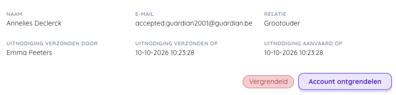

# Mijn leerlingen

## Gekoppelde profielen (voogden/ouders)

Om de details van de gekoppelde profielen van een leerling te zien, klik je in het leerlingenoverzicht op het icoontje met het schild in de kolom 'Voogden'.

### Geblokkeerde voogd

Door te klikken op ontgrendelen, wordt het profiel terug geactiveerd en heeft de voogd opnieuw toegang tot het systeem.  