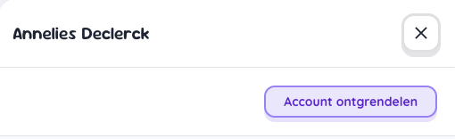

# Gebruikersbeheer

## Overzicht

### Status

#### Vergrendeld

Een gebruiker kan de status **Vergrendeld** krijgen als er teveel mislukte aanmeldpoging werden geregistreerd op te kort tijd. 
Een schoolbeheerder kan leerlingen en voogden/ouders terug ontgrendelen. 

**Gebruiker ontgrendelen**

Klik op de naam van de vergrendelde gebruiker om het detailscherm van de gebruiker te openen. Een vergrendelde gebruiker heeft een knop 'Account ontgrendelen'.

De ontgrendelde gebruiker is nu terug geactiveerd en heeft weer toegang tot het platform.